# Cow Collar: solar GPS + LoRaWAN cattle tracker with anti-theft alerts

**A smart cow collar for African farms.** It tracks cattle by GPS, raises a geofence alert when a cow leaves its grazing zone, monitors activity, and sends an SOS when a thief cuts the strap. It runs on solar power and long-range LoRaWAN radio, so it works in the bush where there is no mobile signal.

Designed for ranchers and smallholder farmers in Zimbabwe.

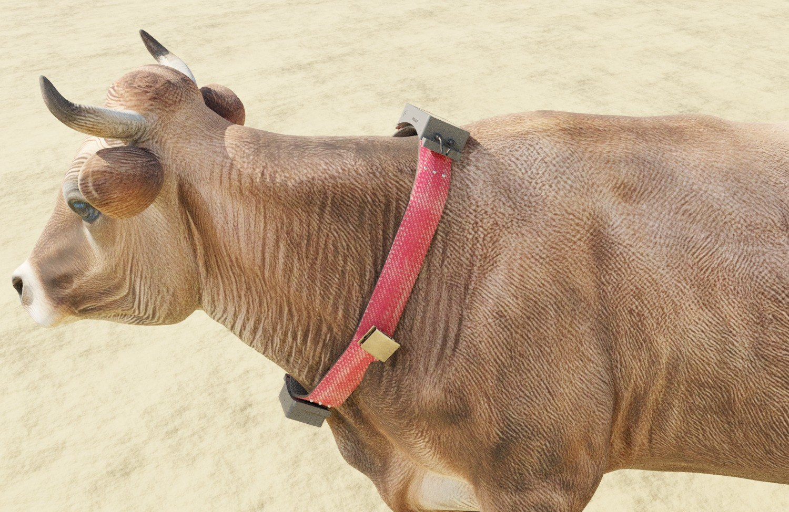

> **Status:** hardware design v0.1 complete (schematic, 4-layer PCB, enclosure, power simulation). Prototype build and field testing are next.

---

## The problem

Cattle are the main store of wealth for many families in Zimbabwe. Animals stray, get lost in the bush, or are stolen at night, and owners often find out days later. Existing GPS collars are expensive, depend on mobile coverage, or are easy to remove.

## What the Cow Collar does

| Feature | How |
|---|---|
| **Live location** | u-blox M10 GNSS, position sent over LoRaWAN |
| **Geofence alerts** | Boundary check runs on the collar itself, alert sent the moment a cow crosses |
| **Anti-theft SOS** | Conductive tamper loops inside the strap + lid-open sensor. If the strap is cut, an on-board energy reserve keeps the collar alive to send SOS messages |
| **Activity and health hints** | 6-axis IMU for steps, grazing and lying time |
| **Long range, no SIM** | LoRaWAN 868 MHz to a solar gateway on a hill, several km in open bush |
| **Runs on sunlight** | Solar panel on the lid, LiFePO4 batteries in a bottom pod that also works as a counterweight |
| **Local alarm** | Buzzer and LED to scare off thieves and help find the animal |

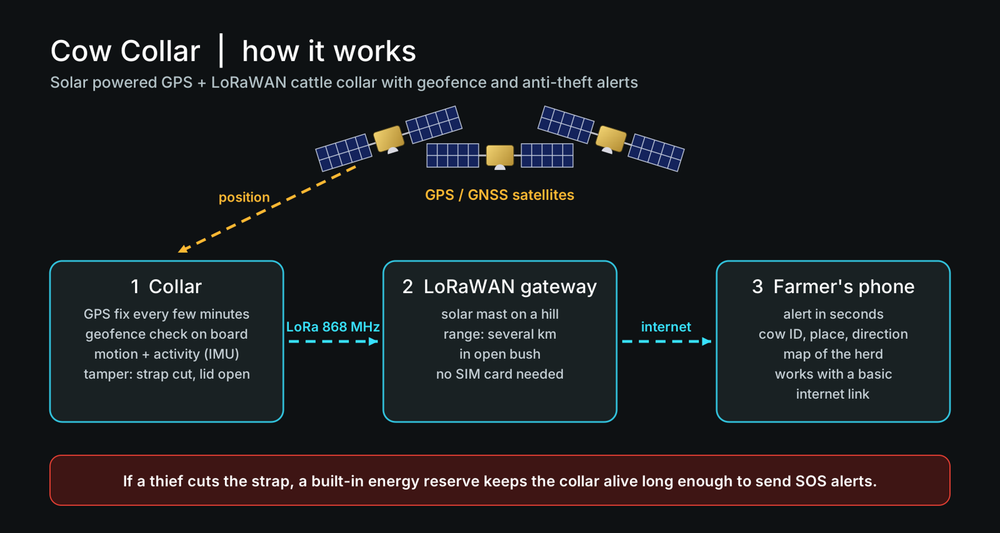

## Hardware architecture

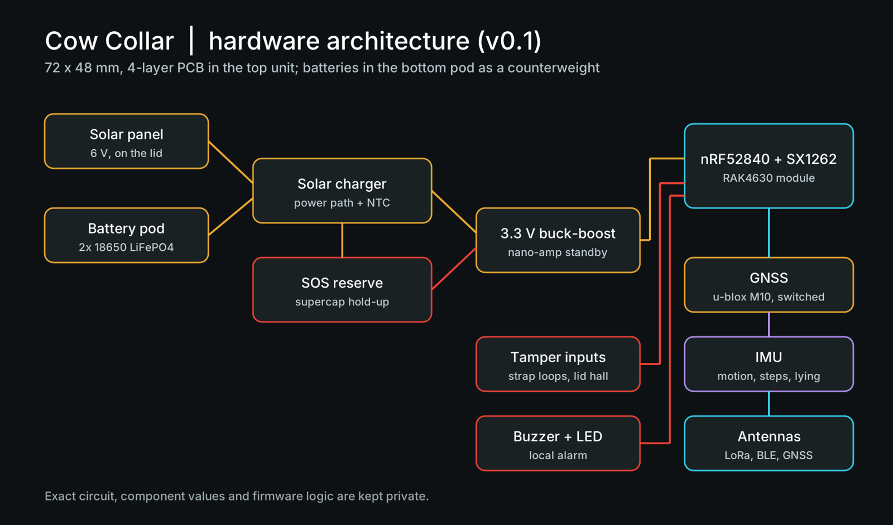

- **MCU + radio:** RAK4630 module (Nordic nRF52840 + Semtech SX1262), LoRaWAN + Bluetooth LE
- **Positioning:** u-blox MAX-M10S GNSS with power switching for low energy use
- **Sensors:** LSM6DSOX IMU, hall-effect lid sensor, strap tamper loops
- **Power:** solar charger with power path, nano-amp buck-boost regulator, 2x 18650 LiFePO4, supercapacitor SOS reserve
- **PCB:** 72 x 48 mm, 4 layers (signal / GND / 3V3 / signal), 50-ohm RF feeds, KiCad DRC clean

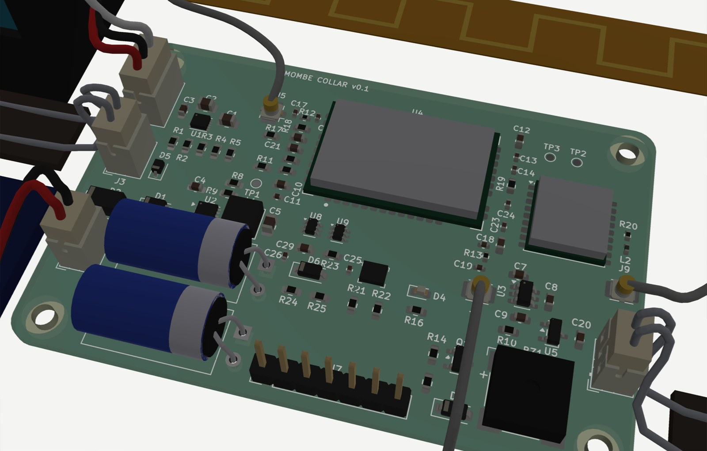

## Engineering highlights

### 1. Surviving a strap cut: SOS power-path simulation
When a thief cuts the strap, the battery cable is cut too. I simulated the hand-over from battery to the supercapacitor reserve in ngspice / LTspice, including the worst case where the blade shorts the battery wires before cutting them.

- The 3.3 V rail never drops during the hand-over, even with the short.
- Firmware order matters: sending the SOS first and keeping the buzzer to short chirps raised the number of SOS messages from 1 to 5.
- Doubling the reserve (a drop-in part swap, no layout change) raised it to 9.

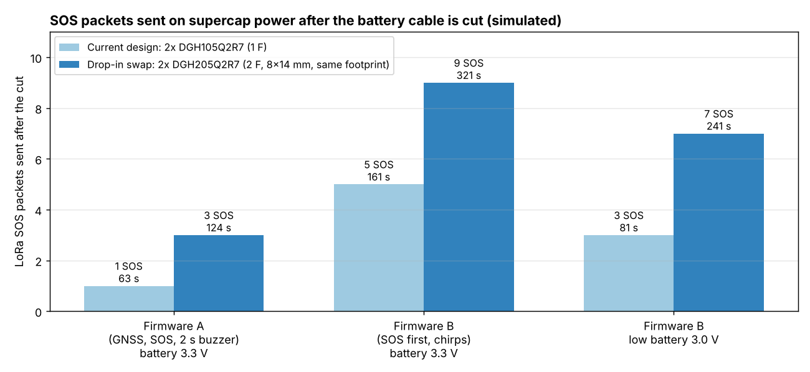

### 2. Enclosure built around the real board
The top unit and battery pod were modelled in CadQuery around the actual KiCad 3D board, with a clearance check against every component. Both have a curved base that fits the neck, strap slots, gasket seal, cable glands, a breathable vent and a magnet post for the lid tamper sensor.

| Top unit, exploded | Top unit, section | Battery pod |
|---|---|---|
| 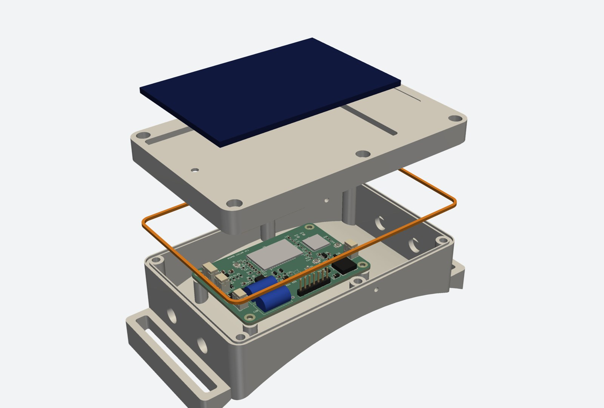 | 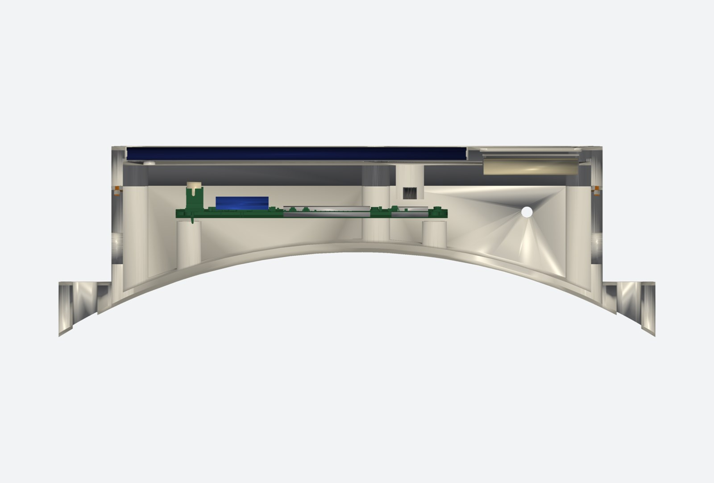 | 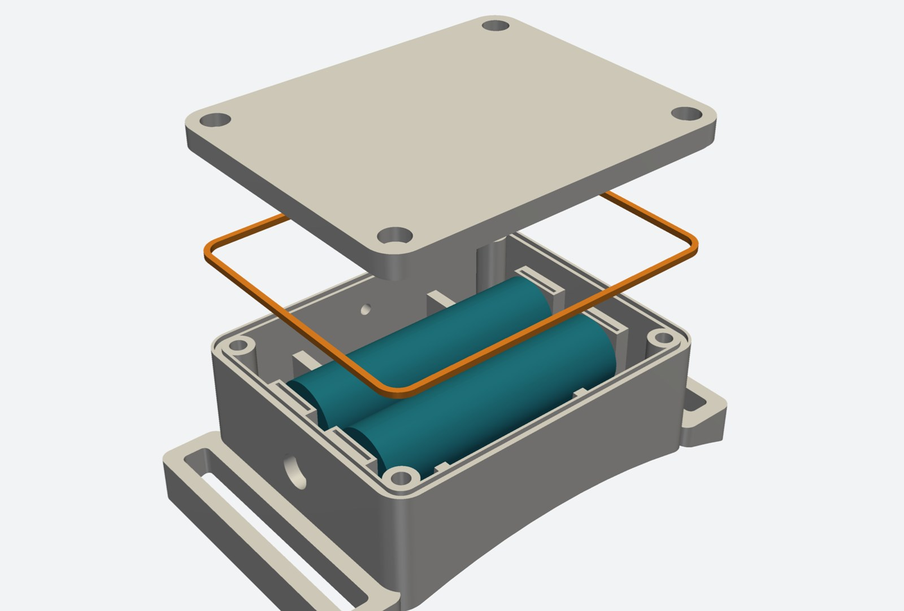 |

### 3. Photoreal product visualisation
Blender renders of the full collar on a cow, with a fire-hose fabric strap, real solar cell detail and stainless hardware.

| Top unit | Solar panel | Battery pod and buckle |
|---|---|---|
| 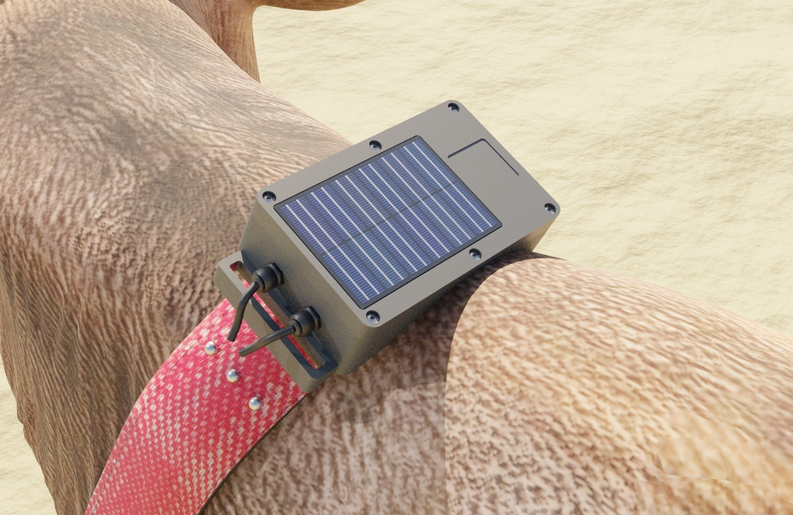 | 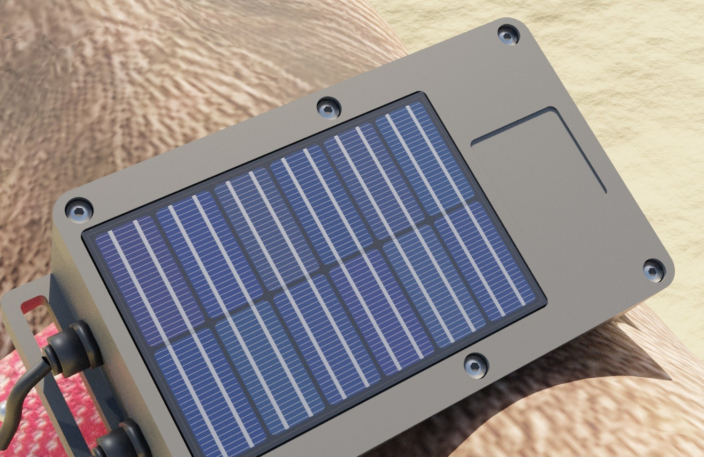 | 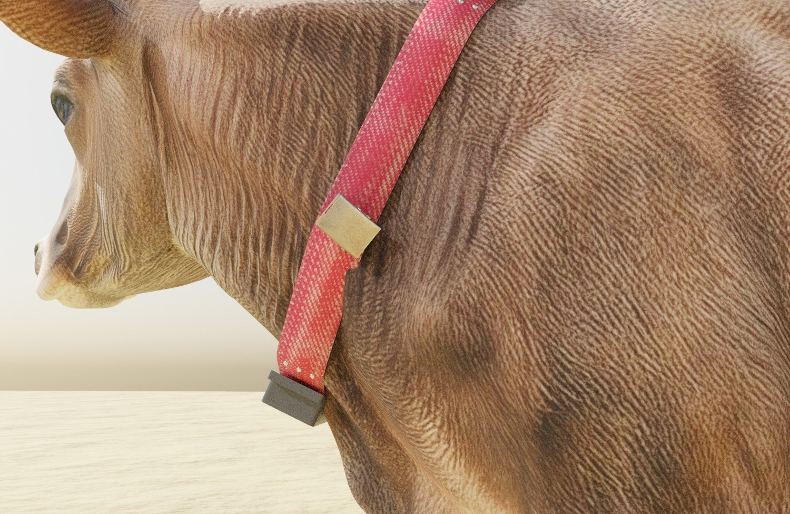 |

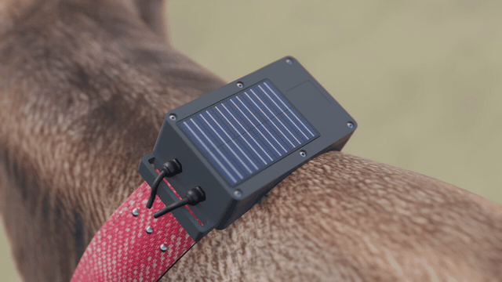

## Tools used
KiCad 10, Freerouting, ngspice / LTspice, CadQuery, Blender (Cycles / Eevee), Python. Design work was done with AI assistance (Claude) under my direction and review.

## Roadmap
- [x] System architecture and component selection
- [x] Schematic and 4-layer PCB (v0.1)
- [x] SOS power-path simulation
- [x] Enclosure v0.1 and product renders
- [ ] PCB fabrication and assembly
- [ ] Firmware: LoRaWAN, geofence, tamper logic, low-power scheduling
- [ ] Bench tests: power budget, range, waterproofing
- [ ] Field trial with cattle in Zimbabwe
- [ ] Slimmer enclosure v0.2 and mobile app

## What is not in this repository
This is a showcase. The schematics, PCB layout files, Gerbers, bill of materials, enclosure CAD and firmware are kept private because the Cow Collar is being developed as a commercial product. Partners, investors and employers can request a walkthrough.

## About
Designed by **Tafadzwa Takawira**, MSc student in Mechatronics and Robotics at Tomsk State University and founder of IO263 (Pvt) Ltd.
Website: [tafadzwatakawira.com](https://tafadzwatakawira.com)

## License
Copyright (c) 2026 Tafadzwa Takawira. All rights reserved. See [LICENSE](LICENSE).
